# Zangetsu

[Русская версия](README.md) · **[Full guide](docs/GUIDE.en.md)** · [Changelog](CHANGELOG.md)

A Minecraft mod (Fabric 1.21.1): Zangetsu from *Bleach*, with a living eye on the blade. The sword comes to you in a dream the first time you go to sleep, grows with your bond, slices arrows and limbs in half, and at the top levels turns you into a Hollow.

**Made by Dobrelya22. Claude (Anthropic's AI) helped only with the code.** This is an unofficial fan mod, not affiliated with the creators or rights holders of *Bleach*.

| | |
|---|---|
| 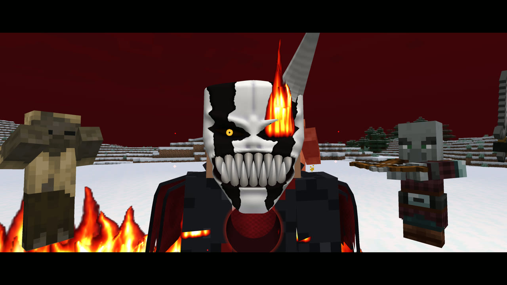 | 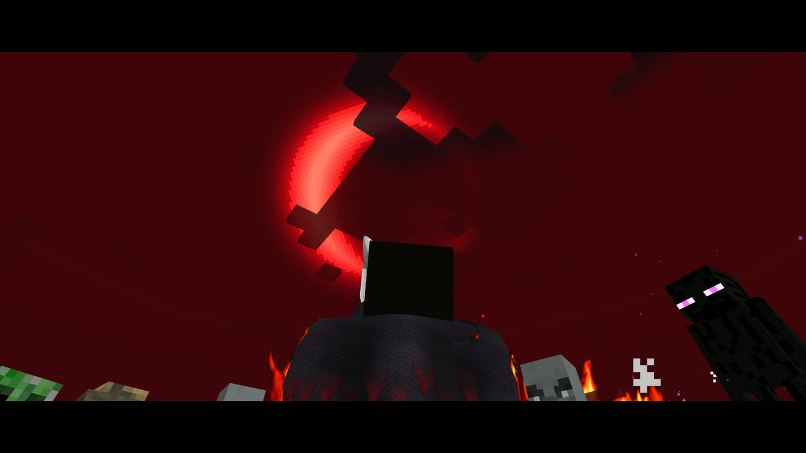 |
| *Die in the Final Form, and the Hollow takes your body. The eye ignites* | *Surrounded, it looks up at the red moon* |
| 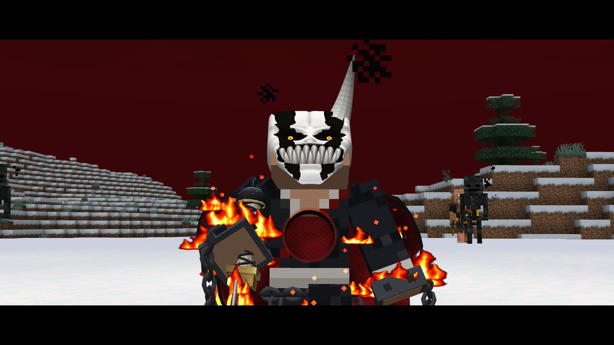 | 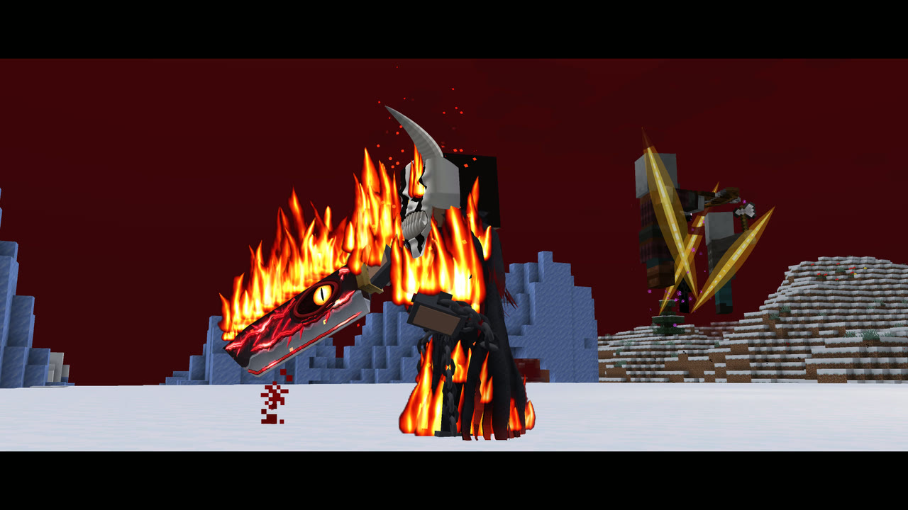 |
| *A perfectly round hole through the chest* | *It leaps through the crowd, then flicks the blood off the blade behind them* |
| 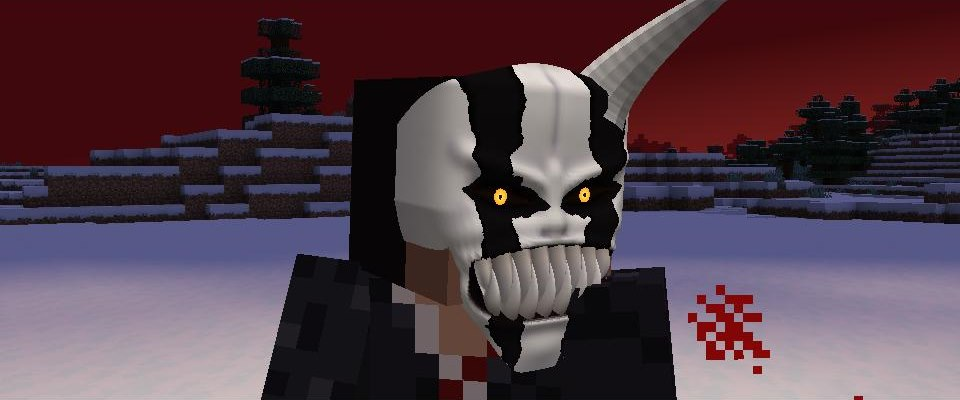 | 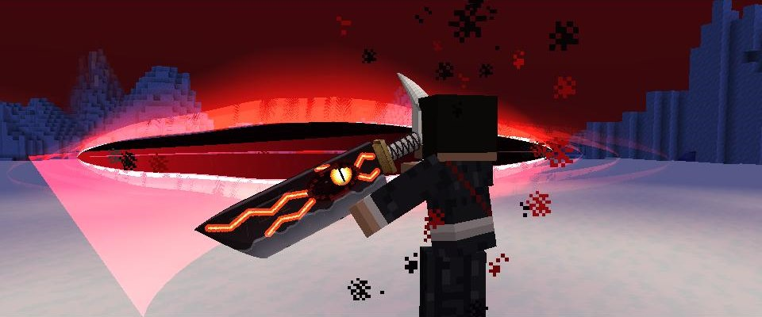 |
| *Level V: the final mask with a single horn* | *The Final Form's Getsuga Tensho: a bigger wave* |
| 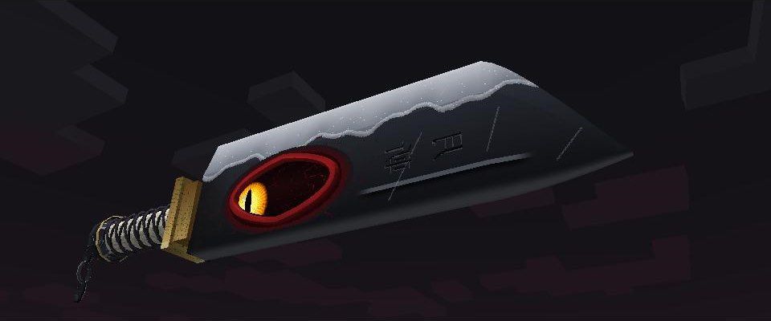 | 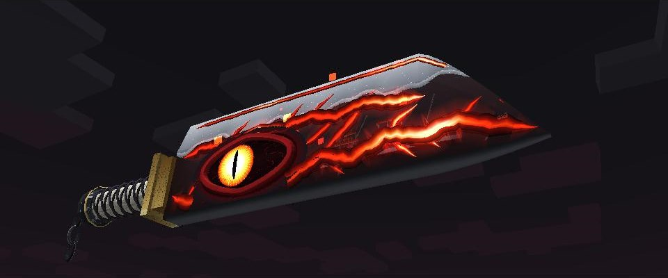 |
| *Zangetsu: hamon, engraving, a living eye* | *In Hollow Form, heat runs through the blade's veins* |
| 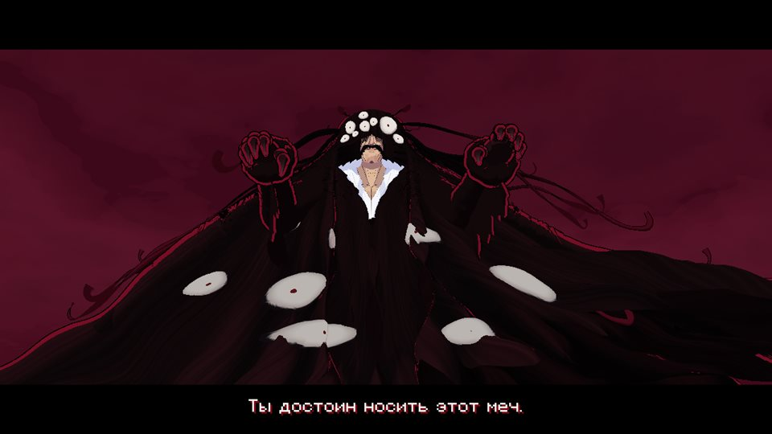 | 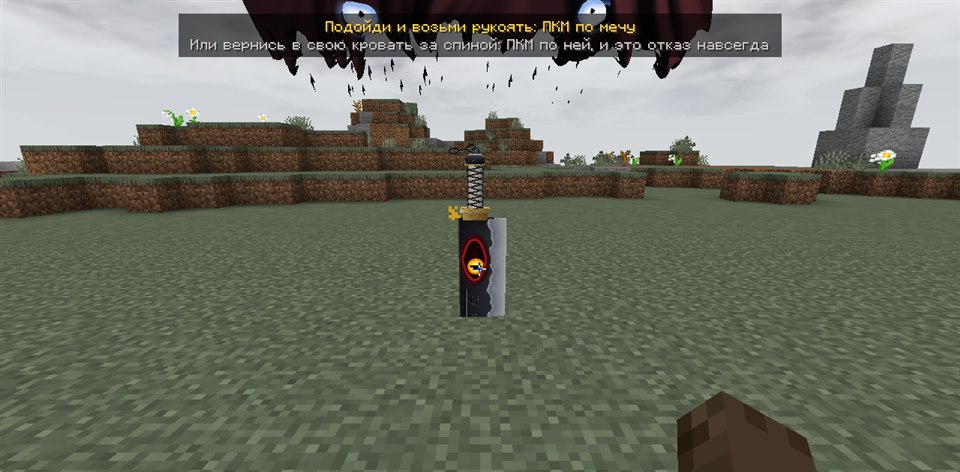 |
| *The first dream: Yhwach floats high above and draws his hands from his cloak* | *Zangetsu plunges blade-first into the ground in front of you* |
| 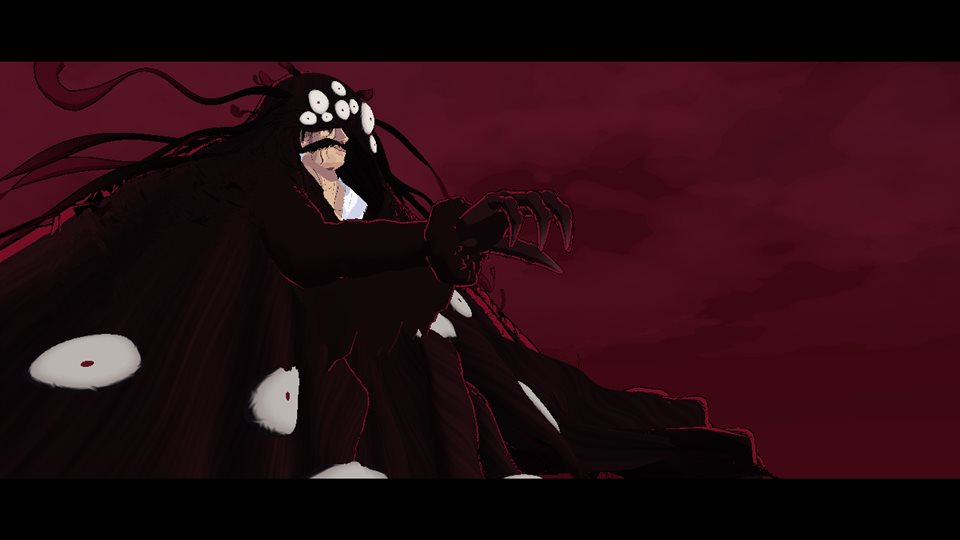 | 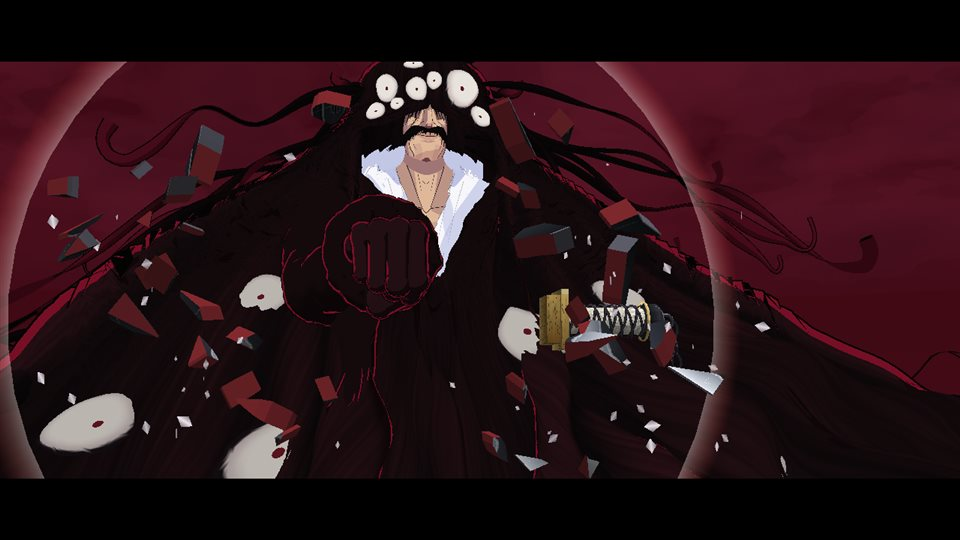 |
| *A deadly blow: he reaches out and beckons the sword* | *One clench of the fist and the blade shatters* |
| 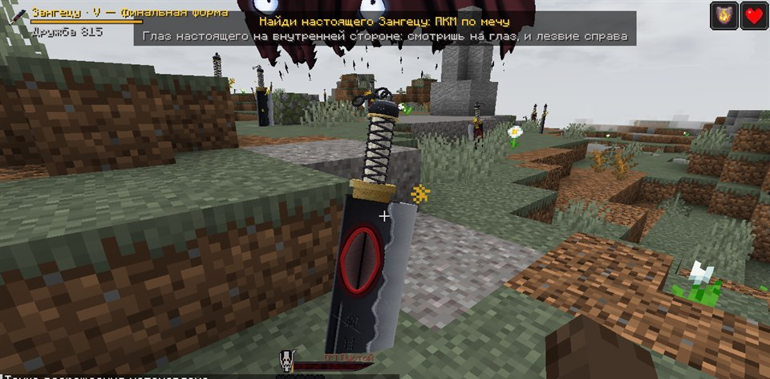 | 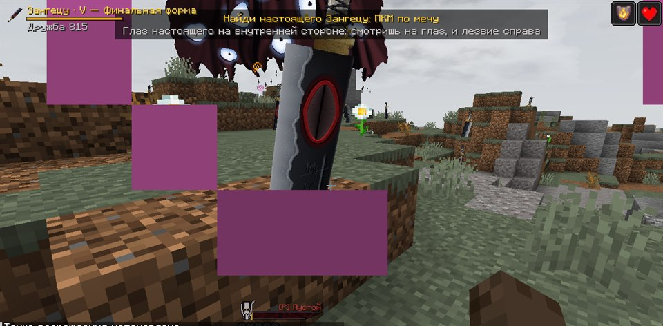 |
| *The true one: face the eye and the edge is on your right* | *A fake: the edge on the left, the eye on the outside* |
| 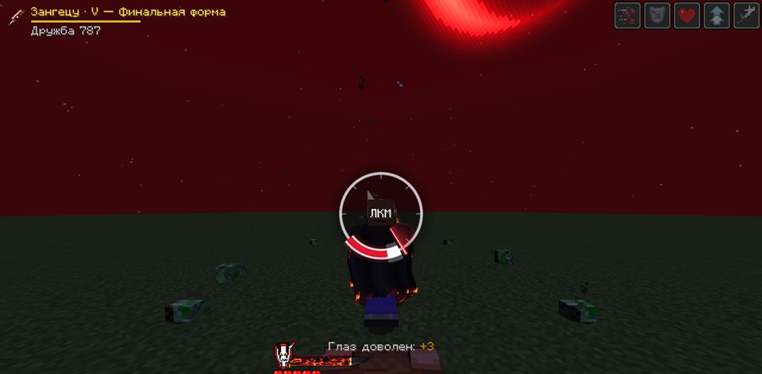 | 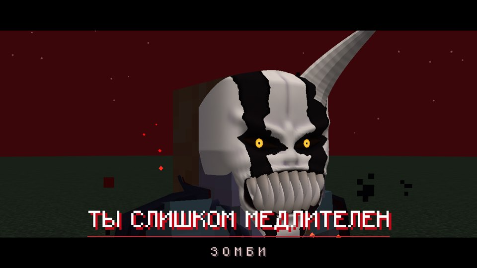 |
| *One hit left: click while the needle is in the zone* | *The white zone: a dash behind the enemy, the mask and the line* |
| 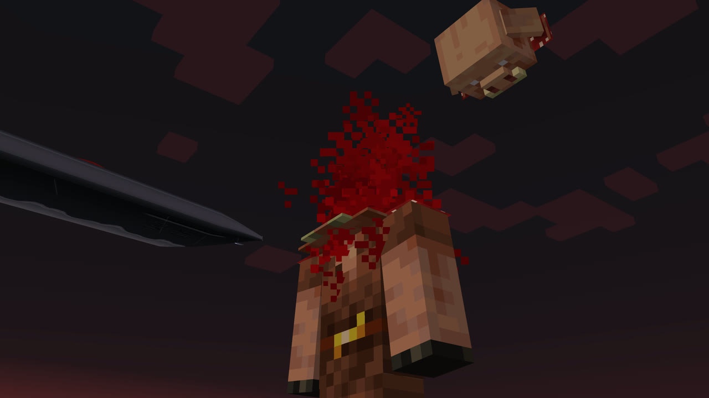 | 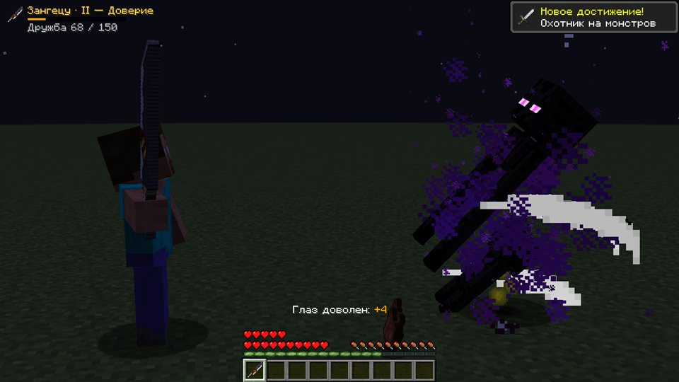 |
| *Executions slice the mob's actual model* | *A kneeless enderman cut in half* |
| 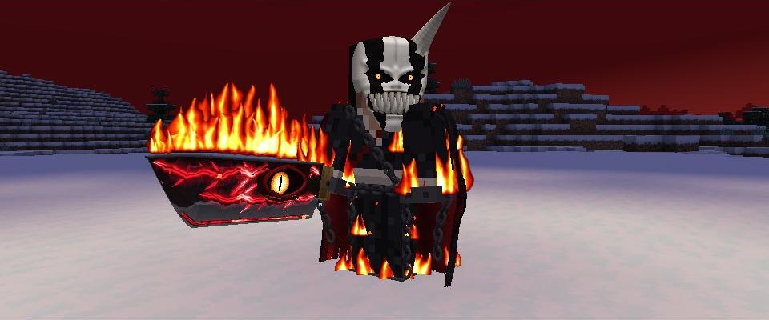 | 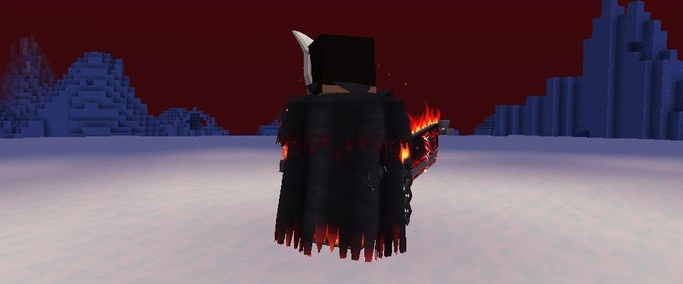 |
| *Final Form: real fire on arms and legs, shackles and chains* | *A torn cloak with smouldering tips and a scarlet lining* |

## Installation

1. Install [Fabric Loader](https://fabricmc.net/use/) 0.16+ for Minecraft **1.21.1**.
2. Download [Fabric API](https://modrinth.com/mod/fabric-api/versions?g=1.21.1) for 1.21.1.
3. Download `zangetsu-*.jar` from the [Releases](../../releases) page.
4. Put both files into `.minecraft/mods` and launch the game with the Fabric profile.

## How it works

### Awakening

You just live in your world, surviving and building. And **the first time you go to sleep**, you have a dream. A crimson, cloudy sky, and high above you floats **Yhwach**: a giant man in a black hooded cloak, always facing you. Long nose, thick moustache, white shirt, large pale eyes looking out from under the hood, and more eyes on his billowing cloak. They look in different directions and blink on their own. He smoothly draws his hands from the inner pockets of the cloak and tells you that you are worthy of carrying this sword, and **Zangetsu emerges right from his chest** and plunges into the ground in front of you. Nothing can hurt you in the dream.

Then the choice is yours.

**Take the sword: right-click it.** You walk up, your hand reaches for the hilt and grips it. At that moment your hearts are restored and you gain **+10 health** (5 hearts) forever. Then with both hands, from a crouch, you smoothly draw the blade from the ground, swing it in a wide arc onto your shoulder, put a hand on your hip, look at the sword and give a short nod: yes, this is my sword. And you wake up where you lay down, already in the morning, sword in hand.

**Refuse: go back to your bed behind you and right-click it.** He says that you have acted unworthily and that your potential is lost forever, then says goodbye. The sword crumbles to dust, the eyes close one by one, and he melts away. **This is permanent:** the dream never comes again and you will never have the sword.

### Death and the field of swords

Zangetsu in your hand or inventory **saves you from death like a totem, but at the cost of itself**. A deadly blow stops time: the world melts into a pale sky, you drop to one knee and the sword hangs in the air before you. Yhwach appears, draws a hand from his pocket and beckons the sword with his fingers. Zangetsu spins up, breaks away and slams into his palm so hard that his arm is thrown back. He holds it by the spine, closes his fingers, and the blade cracks. "I am disappointed. I thought you were stronger." One clench of the fist and the blade flies apart. You live, with the effects of a totem, but the sword is gone. A real totem in your hand triggers first, and the sword does not save you from the void or commands.

The next time you fall asleep, the **field of swords** awaits. Yhwach in the sky says that Zangetsu resents you, and that you must find it among a hundred fakes:

- **The true one has its eye on the inner side of the blade:** face the eye and the edge is on your right.
- **The fakes have the eye on the outside:** the edge is on your left. A fake crumbles in your hand.
- **Can't find it within a minute?** The true sword opens its eye, starts winking and ringing.

Find it and you wake up with the sword and all your progress.

### When the Hollow takes your body

Die in the **Final Form** without a totem and the sword does not break. Something worse happens. You fall to your knees and drive Zangetsu into the ground. "This is not over yet." A perfectly round hole opens through your chest, and from here on you can only watch.

The Hollow rises and beautifully cuts down monsters with its own moves. A crowd surrounds it and closes in. It looks up at the red moon. Its eye ignites. With a blast of power it throws everyone back, then leaps through the zone cutting each of them in half, and a glowing yellow cut stays on every mob. It appears behind the crowd. "Pathetic." One sharp flick shakes the blood off the blade, and at that exact moment everyone behind it falls apart. Then the mask shatters.

You are alive with 5 hearts and your sword intact, but the mask is broken for **one in-game day**.

### The sword is bound to you

- Zangetsu **cannot be thrown away**, either with Q or from the inventory: it returns to your hand.
- It cannot be put into a chest, furnace or crafting table, hung in a frame or given to an armor stand.
- It **does not drop on death**: after respawning you still have it.
- It does not break and does not burn in lava.
- If the sword does get lost (for example, deleted in creative mode), **go to sleep**: you will dream of an endless hilly land with boulders and grass, where **hundreds of identical Zangetsu** are stuck in the ground. Walk up to any of them and take it: the sword rises from the ground, the screen floods white, and you **wake up in the morning with the sword and all its progress**.

### The eye and your bond

The sword is detailed and fully 3D: a cleaver blade with a hamon, engraving and a sharpened silver edge, a ray-skin grip wrapped in a raised cross-laced cord, a brass flange, a blued pommel and a piece of chain that swings and hangs by gravity. The eye on the blade is a living 3D part on the inner side facing its owner, with a shiny cornea: it looks at the nearest evil mob, otherwise at you, glances around now and then, and blinks. In the inventory it follows your cursor.

You have to befriend the eye: **kill evil mobs and spare the good ones**.

- Defeating an evil mob raises your bond (tougher mobs give more; bosses give +60 at once).
- Killing a good mob (animals, villagers, golems and other peaceful mobs) lowers it (villagers and golems more).
- If your bond falls below zero, the eye **squints angrily** and will not help until you make amends.

**At night or in the dark** (in a cave) the eye **opens**, and that's when the fun begins. In daylight the eye is closed and the sword is just a very strong sword.

### Five levels

| Level | Bond | What the sword can do while the eye is open |
|---|---|---|
| I "Awakening" | 0 | Arrows flying at you are **sliced in half**. Ghast fireballs and tridents are deflected back |
| II "Trust" | 50 | Mob attacks are **parried**, and the sword **severs a limb** in return. **Executions** unlock |
| III "Unity" | 150 | The sword **strikes** nearby evil mobs **on its own** (neutral ones are left alone until they attack) |
| IV "Hollow" | 350 | **Hollow Form**: a 2-minute gauge that refills every day and with every kill |
| V "Final Form" | 700 | Hollow Form becomes **final**: a horned mask with black stripes, fire on arms and legs, a cloak and chains, stronger effects, a bigger and deadlier Getsuga Tensho, and **executions from a distance** |

Sword damage grows with every level.

### Limbs and executions

- **Zombies, piglins, skeletons:** the first parried blow takes off the **left arm**, the second the **right**. Without arms a mob cannot attack and drops its weapon.
- **Endermen:** the sword goes for the **knees**. With the left knee cut, the enderman stands on one leg and can no longer teleport; with the right one too, it sinks onto its stumps and cannot move.
- **An execution is a reaction check.** When the enemy you are fighting has one hit left or there is nothing left to cut off, it freezes and a ring with a needle appears in the middle of the screen. Click **left mouse button** while the needle is inside the zone. Miss or click too late and the enemy recovers, so you have to finish it with a normal hit.
- **The zone depends on your power.** From level II without the mask it is small, in Hollow Form medium.
- **The Final Form adds a small white zone.** A great hit: the action freezes for a moment, the camera rushes to the enemy's face, you appear behind it, a big close-up of the mask, "YOU'RE TOO SLOW" and the enemy's name on screen, then one fast strike from behind. A good hit: a quick execution with a dash of up to 18 blocks.

An execution slices the mob's actual model, so the pieces are solid and the cut shows what it's made of. The move is random and never the same twice in a row:

| Mob | Normal execution | Great reaction, from behind |
|---|---|---|
| Most mobs | head off, in half at the waist, top to bottom, diagonally from the shoulder, diagonally upward from the hip, across the chest, upward through the whole body | a cross, into four pieces, three strikes in a row, into slices, one stroke with a delayed split, upward through the whole body |
| Skeleton | bursts into bones, head off, from the shoulder, from the hip, across the chest | bones, a cross, four pieces, delayed split, slices |
| Wither skeleton | bones in smoke and soul fire, top to bottom, at the waist, from the hip, across the chest | bones, a cross, four pieces, three strikes, slices, delayed split |
| Creeper | launched and bursts in mid-air harming no one, top to bottom, head off, at the waist, upward through the body | launched, four pieces, slices, delayed split, upward through the body |
| Enderman | at the waist, from the shoulder, top to bottom, from the hip, across the chest | a cross, four pieces, three strikes, slices, delayed split |
| Ravager | top to bottom, at the waist | four pieces, top to bottom, at the waist |

### Attacks

Instead of the vanilla jab there are real moves, both in third and first person:

- **A chain of eight moves**: a two-handed diagonal, a wide swing, a rising cut, a two-handed overhead chop, a backhand, a two-handed upswing, a two-handed thrust and a full-body spin at the end. Torso and legs follow the strike, and a trail follows the blade's real path.
- **Weight**: wind-up, a short pause, acceleration, follow-through. Damage lands when the blade reaches the target; on a hit the strike freezes for an instant, the camera shakes and sparks fly. A press during an attack is remembered and the next move starts on its own.
- **The hilt is always in your fist**: the sword rotates around the grip. In first person you see your hand on the hilt, both hands in two-handed moves, and the blade turning its different sides.

### Hollow Form

At level IV, the **H** key turns you into a Hollow: your hand passes over your face and the bone mask of Ichigo appears right behind your palm, with sculpted brows, eye sockets and cheekbones, two dark-scarlet stripes, narrow eye slits with yellow irises and a grin of real 3D teeth. **The sword's eye burns**, glowing cracks run along the blade, the sun and the ordinary moon fade, and a **blood-red crescent moon** appears high in the sky, turning the sky and the fog red. Everyone nearby sees it.

In this form you get strength, speed, damage resistance and regeneration, all sword abilities work even in daylight, and parrying is always active. **Right-click with the sword** for **Getsuga Tensho**: you raise the blade high above your head, it freezes and trembles with gathered power, and with a wide horizontal swing you release a huge wave of black energy with a scarlet glow and a white-hot edge.

The form runs on a **2-minute gauge**, shown as a **living blade above your hearts** instead of a timer. It refills every new day **and with every evil mob you kill**: 5 seconds for a zombie, 3 to 30 seconds depending on how tough the mob is, half as much while in the form. So you can awaken the form several times a day if you keep fighting. Press H again to take the mask off and save the rest. At 30 seconds the mask cracks, at 15 a piece chips off, at 5 it nearly crumbles, and then it shatters and you are exhausted for a moment.

At **level V** the form becomes **final**: the stripes turn black and jagged, the eyes get a black outline and **a single long horn** grows above the temple. Strength and speed are higher, and Getsuga Tensho is 45% larger and deals 28 damage instead of 18.

### Transformations

Damage to the player does not pass during these scenes and the form's gauge is not spent.

- **Level IV, 3.6 seconds:** the head lowers, the free hand rises to the forehead and slowly passes over the face. The mask appears right behind the palm, the edge of the growing bone glowing hot. As soon as the mask is ready the hand whips aside, the head lifts and the eyes ignite.
- **Level V, almost 9 seconds:** he trembles with rage, the heartbeat quickens, and the mask crawls up from the chin. Lightning (harmless) drives him onto one knee with the sword in the ground, bringing the cloak, chains and fire all at once. He rises, the eyes ignite, he throws the sword onto his shoulder in a big arc and strikes with a lunge. The lunge throws everyone back and hurts evil mobs in front of him.

### Cloak, chains and fire of the Final Form

- **The cloak** is real cloth: it lags behind a dash, streams behind a runner, wraps around on a turn, flows around arms and legs and settles on the ground when you crouch.
- **The chains** are heavy and hang by gravity: they swing as you run, calm down fast and **ring** when jerked.
- **The fire** is alive: it lags behind a moving arm and blade, blows back as you run, flares up from strikes, Getsuga and executions, and throws sparks. When you calm down, so does the fire.

## Controls

| Action | Key |
|---|---|
| Take the sword (awakening and dreams) | RMB on the sword in the ground |
| Execution | LMB while the needle is in the zone |
| Hollow Form | `H` |
| Getsuga Tensho (in Hollow Form) | RMB with the sword |

Keys can be changed: Options → Controls → "Zangetsu".

The top left shows your level and bond to the next level, and the Hollow's power is above your hearts. Hover over the sword in the inventory to see its owner, level, bond and unlocked abilities.

## Testing commands

These require cheats:

| Command | What it does |
|---|---|
| `/zangetsu awaken` | Start the first dream right away (and lift a refusal) |
| `/zangetsu give` | Get the sword without the scene |
| `/zangetsu level 1..5` | Set your level |
| `/zangetsu bond <number>` | Set your bond |
| `/zangetsu hollow` | Refill the form gauge |
| `/zangetsu dream` | Go to the dream of swords |
| `/zangetsu break` | Show Yhwach breaking the sword |
| `/zangetsu rampage` | Show the Hollow taking over (requires level V) |
| `/zangetsu reset` | Reset everything: sword, bond, health bonus, refusal |

## Credits

**Mod by Dobrelya22.** Claude (Anthropic's AI) helped only with the code. *Bleach*, Zangetsu, Ichigo and Yhwach belong to Tite Kubo and their respective rights holders; this is a free, unofficial fan project.
