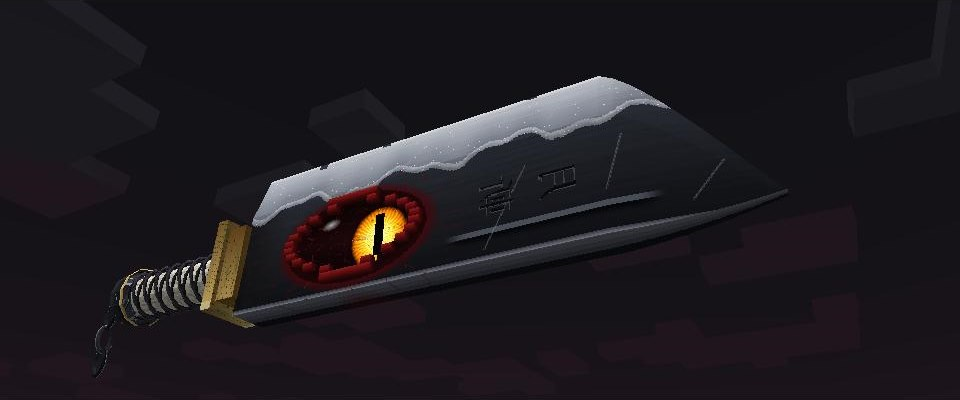
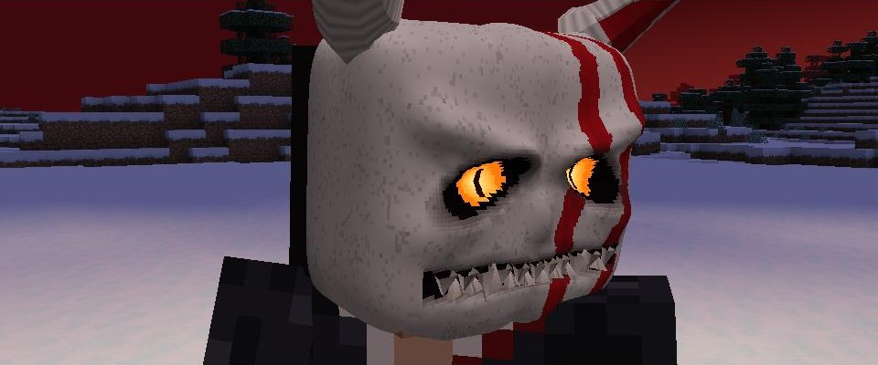
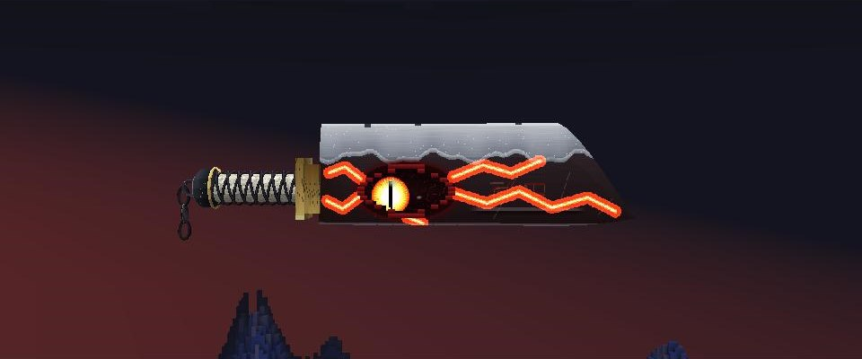
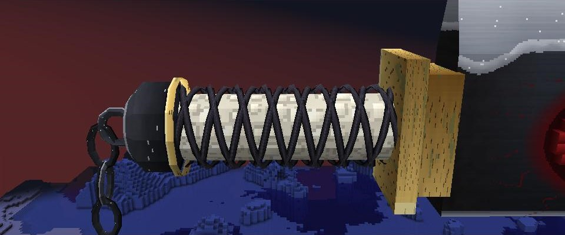
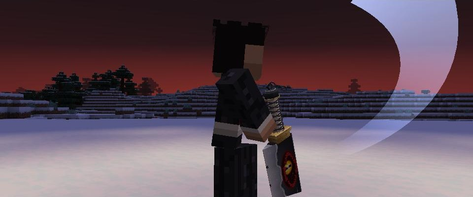
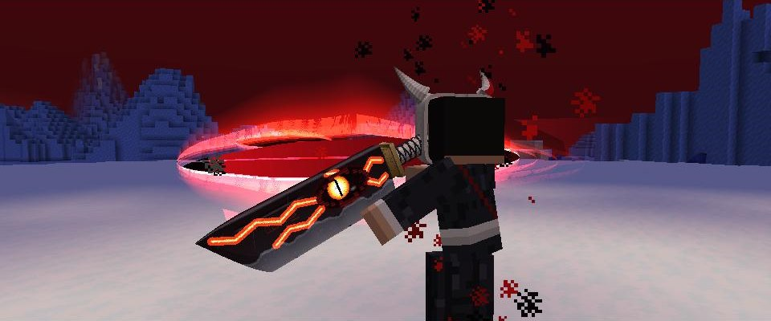
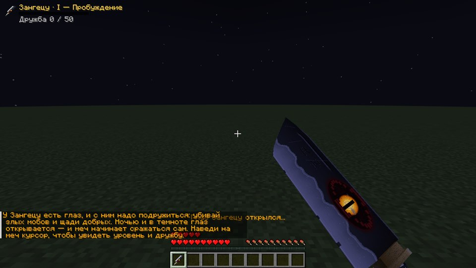

# Зангецу

Мод для Minecraft (Fabric 1.21.1): меч Зангецу из «Блича» с живым глазом — жёлтая радужка, тигриный зрачок. Меч сам находит тебя, когда ты на волоске от смерти, растёт вместе с вашей дружбой, рубит стрелы и конечности, а на последнем уровне превращает тебя в Пустого.

| | |
|---|---|
|  |  |
| *Зангецу: хамон, гравировка, живой глаз* | *Маска Пустого: оскал, светящиеся глазницы, рога* |
|  |  |
| *В форме Пустого по клинку бегут алые трещины* | *Шнур крест-накрест, латунный фланец, обломок цепи* |
|  |  |
| *Удары — настоящие взмахи со светящейся дугой* | *Гецуга Теншо: замах над головой — и горизонтальный взмах* |
|  |  |
| *Одно сердце — в небе появляется фигура с мечом* | *Зангецу вонзается лезвием в землю перед тобой* |
|  |  |
| *Коснулся рукояти — меч выбрал тебя* | *Объёмный Зангецу: лезвие вниз, глаз живой* |
|  |  |
| *Гецуга Теншо — горизонтальная волна чёрной энергии* | *Ночью меч рассекает стрелы пополам* |
|  |  |
| *Обе руки отсечены — можно казнить* | *Казнь: голова отлетает* |
|  |  |
| *Эндермен без колен рассечён пополам* | *Маска Пустого трескается, когда время на исходе* |
|  |  |
| *Зангецу от первого лица: глаз открывается ночью* | *Время формы Пустого — маска в углу экрана* |
|  |  |
| *Обычная луна исчезает — в небе кровавый серп* | *Сон: бескрайние холмы и сотни мечей* |

## Установка

1. Установи [Fabric Loader](https://fabricmc.net/use/) 0.16+ для Minecraft **1.21.1**.
2. Скачай [Fabric API](https://modrinth.com/mod/fabric-api/versions?g=1.21.1) для 1.21.1.
3. Скачай `zangetsu-*.jar` со страницы [Releases](../../releases) (или из последней сборки во вкладке Actions).
4. Положи оба файла в папку `.minecraft/mods` и запусти игру с профилем Fabric.

## Как всё устроено

### Пробуждение

Когда у тебя остаётся **одно сердце**, время будто замирает: мобы вокруг вязнут, на экране — «Ты ещё не готов умереть...». В небе проступает **таинственная фигура** — рогатая, с перепончатыми крыльями и хвостом, глаза светятся жёлтым. Она замахивается и **бросает тебе Зангецу**: меч летит, кувыркаясь, и вонзается лезвием в землю прямо перед тобой (ударная волна раскидывает мобов). Пока идёт эта сцена, ты неуязвим.

Подойди и **коснись рукояти** (ПКМ по мечу) — камера уходит за спину, рука тянется к мечу, вспышка, меч всплывает перед глазами, как тотем. Сердца восстанавливаются, и добавляется ещё **+10 здоровья** (5 сердец) — навсегда.

В пещере фигура появляется ближе и меньше, чтобы её было видно.

### Меч привязан к тебе

- Зангецу **нельзя выбросить**: ни клавишей Q, ни из инвентаря — он возвращается в руку.
- Его нельзя положить в сундук, печь, на верстак, повесить в рамку или отдать стойке.
- Он **не выпадает при смерти** — после возрождения он снова у тебя.
- Не ломается и не горит в лаве.
- Если меч всё же пропал (например, удалён в творческом режиме), **ляг спать**: тебе приснится бескрайняя холмистая земля с валунами и травой, где в землю воткнуты **сотни одинаковых Зангецу** — куда ни беги, впереди появляются новые. Подойди к любому и возьми его — меч поднимается из земли, экран заливает белым, и ты **просыпаешься утром с мечом и всей его прокачкой**.

### Глаз и дружба

Меч объёмный и детальный: клинок-тесак с хамоном, гравировкой и заточенной серебряной кромкой, рукоять из кожи ската, обвитая выпуклым шнуром крест-накрест, латунный фланец, воронёное навершие и обломок цепи, который качается и висит по силе тяжести. Глаз на клинке — живая 3D-деталь с обеих сторон, с блестящей роговицей: он смотрит на ближайшего злого моба, а если их нет — на тебя, иногда поглядывает по сторонам и моргает. В инвентаре он следит за курсором.

На клинке живёт глаз, и с ним надо подружиться: **убивай злых мобов и щади добрых**.

- Победа над злым мобом — дружба растёт (чем крепче моб, тем больше; боссы — сразу +60).
- Убийство доброго моба (животные, жители, големы, тихони) — дружба падает (жители и големы — сильнее).
- Если дружба ушла в минус, глаз **сердито щурится** и ничем не помогает, пока ты не загладишь вину.

**Ночью или в темноте** (в пещере) глаз **открывается** — и тогда начинается самое интересное. Днём на свету глаз закрыт и меч — просто очень сильный меч.

### Четыре уровня

| Уровень | Дружба | Что умеет меч, когда глаз открыт |
|---|---|---|
| I «Пробуждение» | 0 | Стрелы, летящие в тебя, **рассекаются пополам** — две половинки разлетаются и падают. Огненный шар гаста и трезубец отбиваются обратно |
| II «Доверие» | 50 | Удары мобов **парируются**, а в ответ меч **отсекает конечность**. Открывается **казнь** |
| III «Единство» | 150 | Меч **сам рубит** ближайших злых мобов (нейтральных не трогает, пока те сами не нападут) |
| IV «Пустой» | 350 | **Форма Пустого** — 2 минуты в игровые сутки |

С каждым уровнем растёт и урон меча.

### Конечности и казнь

- **Зомби, пиглины, скелеты:** первый парированный удар — отлетает **левая рука**, второй — **правая**. Без рук моб не может бить и роняет оружие. Наведи на него прицел — появится **«[R] КАЗНЬ»**: камера уходит за спину, ты заносишь меч двумя руками и **отрубаешь мобу голову**.
- **Эндермены:** меч бьёт **по коленям**. Левое колено рассечено — эндермен стоит на одной ноге и уже не может телепортироваться; правое — оседает на обрубки и не может сдвинуться с места. Казнь — **горизонтальный удар, рассекающий его пополам**: верхняя половина съезжает и падает.

### Удары

Вместо ванильного тычка — настоящие взмахи, и со стороны, и от первого лица:

- **Обычные удары** идут по очереди: диагональ сверху, восходящий снизу, горизонтальный. Корпус проворачивается, вторая рука помогает, клинок разворачивается лезвием вперёд, за ним остаётся стальная дуга.
- **Меч бьёт сам** (уровень III): он рывком тянет руку в сторону врага, след — золотой.
- **Гецуга Теншо** — замах над головой и горизонтальный взмах, след — алый.

### Форма Пустого

На IV уровне клавиша **H** превращает тебя в Пустого: ты раскидываешь руки и ревёшь, на лице нарастает объёмная костяная **маска** — надбровья и скулы, светящиеся глазницы, оскал из отдельных зубов, **алые полосы и длинные изогнутые рога**. **Глаз меча горит**, по клинку бегут светящиеся трещины, обычная луна исчезает, а высоко в небе проступает **кровавая серповидная луна** — небо и туман краснеют (это видят все рядом).

В этой форме: сила, скорость, сопротивление урону, регенерация, все способности меча работают даже днём, парирование — всегда. **ПКМ с мечом** — **Гецуга Теншо**: ты заносишь клинок высоко над головой, он замирает и дрожит от собранной силы — и широким горизонтальным взмахом ты срываешь огромную волну чёрной энергии с алым свечением и раскалённой кромкой. Она оставляет шлейф и рубит злых мобов на своём пути.

На всё — **2 минуты в игровые сутки**, их можно тратить частями (H ещё раз — снять маску). Сколько осталось, показывает **маска в углу экрана**: светлая часть тает сверху вниз. На 30 секундах маска трескается, на 15 от неё откалывается кусок, на 5 она почти рассыпается — а потом раскалывается, и ты ненадолго истощён.

## Управление

| Действие | Клавиша |
|---|---|
| Взять меч (при пробуждении и во сне) | ПКМ по воткнутому мечу |
| Казнь моба под прицелом | `R` |
| Форма Пустого | `H` |
| Гецуга Теншо (в форме Пустого) | ПКМ с мечом |

Клавиши можно поменять: Настройки → Управление → «Зангецу».

Слева вверху — уровень, дружба до следующего уровня и время формы Пустого. Наведи курсор на меч в инвентаре — увидишь хозяина, уровень, дружбу и открытые способности.

## Команды для проверки

Нужны читы (`/gamemode`-права):

| Команда | Что делает |
|---|---|
| `/zangetsu awaken` | Сразу запустить пробуждение (фигура в небе) |
| `/zangetsu give` | Сразу получить меч без сцены |
| `/zangetsu level 1..4` | Поставить уровень |
| `/zangetsu bond <число>` | Поставить дружбу |
| `/zangetsu hollow` | Восстановить 2 минуты формы Пустого |
| `/zangetsu dream` | Отправить в сон с мечами |
| `/zangetsu reset` | Сбросить всё: меч, дружбу, бонус к здоровью |

## Для разработчиков

- Сборка: `./gradlew build` → `build/libs/zangetsu-*.jar`.
- Текстуры нарисованы кодом: `tools/textures.cs` (запуск — `tools/textures.ps1` в Windows PowerShell).
- `./gradlew runShots` — игра сама проходит все сцены мода и делает скриншоты в `run-shots/screenshots` (то же в GitHub Actions: workflow **shots**).
- `./gradlew runTrailer -PtrailerStills=stills` — игра сама разыгрывает и снимает трейлер кино-камерой, кадр за кадром (60 в секунду), и сохраняет стоп-кадры; с `-PtrailerVideo=trailer.mkv` пишет видео через ffmpeg. Весь ролик с цветом и музыкой собирает workflow **trailer**.
- `./gradlew runTrailer -PtrailerScript=showcase -PtrailerStills=stills` — витрина для проверки графики: крупные планы меча и маски со всех сторон и все анимации ударов, со стороны и от первого лица (`-PtrailerScenes=sword,mask` — только нужные сцены).
