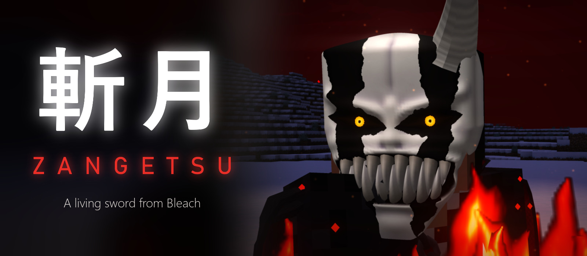

## Your sword is alive. And it chooses you.

**Zangetsu** is a story-driven sword mod for Minecraft, inspired by *Bleach*. You don't craft this weapon, and you won't find it in a chest. It comes to you in a dream. A living eye watches from the blade, your bond with it grows with every fight, and the power it gives you has a price.

This isn't just a stronger sword. It's a whole journey: from the first dream, through a Hollow's mask and a burning Final Form, to the moment you die and something else gets up in your place.

*Made by **Dobrelya22**. Claude (Anthropic's AI) helped only with the code. A free, unofficial fan mod. Bleach, Zangetsu, Ichigo and Yhwach belong to Tite Kubo and their respective rights holders.*

*Fabric · Minecraft 1.21.1 · Java 21 · Requires Fabric API, on both client and server · English and Russian*

## Watch the music video

[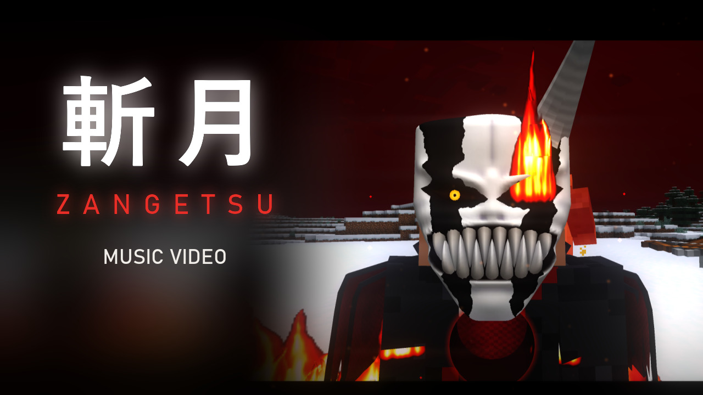](https://youtu.be/bQY_-Fg9X2M)

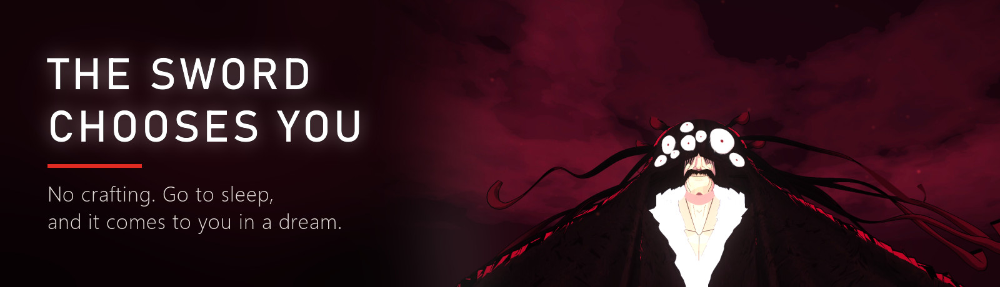

Go to sleep in a bed for the first time and you'll find yourself under a crimson sky, with a giant cloaked figure watching you from above. He tells you that you're worthy, and the sword plunges into the ground at your feet.

**Then the choice is yours.** Take the hilt and wake up with the sword and 5 extra hearts. Or go back to your bed and lose it forever.

Once it's yours, it's only yours: it can't be dropped, stored away or lost on death. And if it ever goes missing, go to sleep. It will be waiting in your dream.

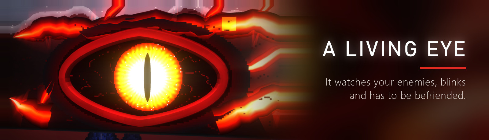

The eye on the blade really looks around. It tracks the nearest enemy, glances at you, follows your cursor in the inventory, and blinks. You have to earn its trust: **kill evil mobs and spare the good ones**. Hurt the innocent, and it squints angrily and refuses to help until you make amends.

It opens at night and in the dark, and that's when the real power wakes up.

| Level | Bond | What you get |
|---|---|---|
| **I. Awakening** | 0 | The sword slices arrows in mid-air and deflects fireballs and tridents |
| **II. Trust** | 50 | Parries attacks, severs limbs, unlocks executions |
| **III. Unity** | 150 | The sword strikes nearby evil mobs on its own |
| **IV. Hollow** | 350 | Hollow Form and Getsuga Tensho |
| **V. Final Form** | 700 | Horned mask, fire, cloak and chains, long-range executions |

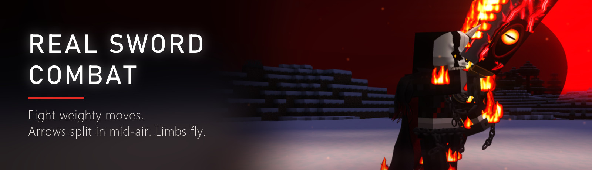

Forget the vanilla jab. Zangetsu has **eight moves that flow into a combo**, in both first and third person: two-handed cuts, an overhead chop, a thrust and a full-body spin. Every swing has weight: a wind-up, a pause, and an impact you can feel.

Attacks get parried and limbs fly off. Zombies and skeletons lose their arms and drop their weapons. Endermen get their knees cut, so they can't teleport or run away.

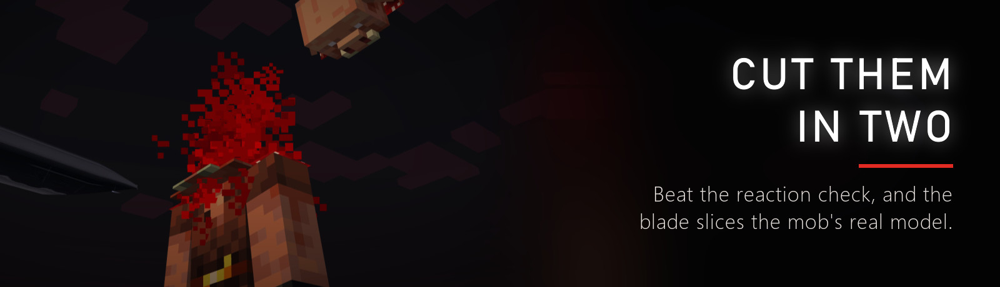

When an enemy has one hit left, it freezes and a ring appears on screen. **Click while the needle is in the zone**, and the blade cuts through the mob's actual model, so the pieces are solid and every cut shows what's inside.

Heads off, cut in half at the waist, sliced diagonally, into quarters, into slices: there are more than a dozen ways, and every mob type has its own. Skeletons burst into bones. Creepers get launched and explode in mid-air, harming no one.

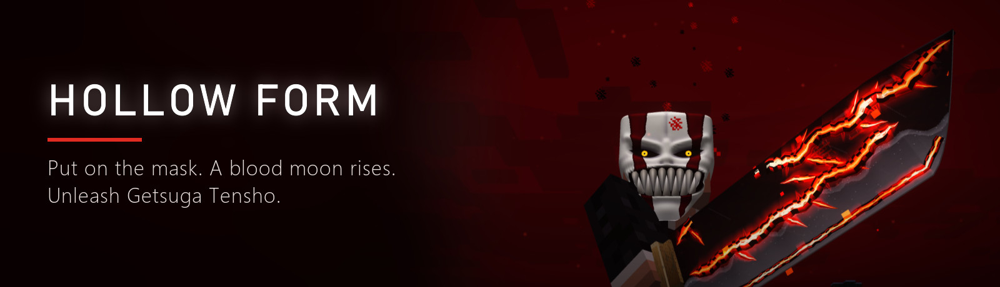

Press `H`. Your hand passes over your face, and a bone mask grows behind your palm. The sun fades, a **blood-red crescent moon** rises, and the sword catches fire from within.

You get strength, speed and regeneration, and your abilities work even in daylight. Right-click to fire **Getsuga Tensho**, a huge wave of black energy that cuts down everything in its path. The living blade above your hearts shows how long the power lasts, and every monster you kill refills it. When it runs out, the mask cracks and shatters.

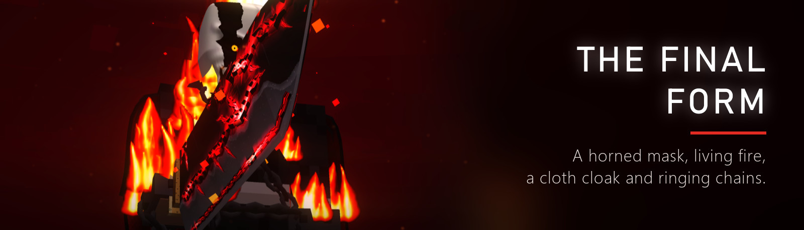

At the highest level, lightning drives you to your knees and you rise as something else: a horned mask, **real fire on your arms and legs**, a cloth cloak that streams behind you, and heavy chains that ring with every move.

Executions now reach up to 18 blocks. Hit the small white zone on the ring, and everything freezes: "YOU'RE TOO SLOW", a dash behind the enemy, one strike from the back.

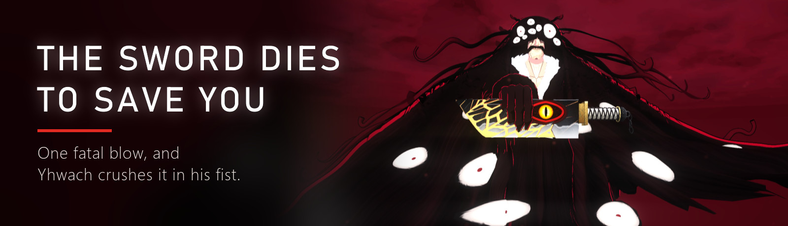

In this mod, even death is a story. A fatal blow stops time. Yhwach reaches down, the sword flies into his palm, and it cracks in his grip. "I am disappointed. I thought you were stronger." One clench of the fist, and it shatters to save your life.

To get it back, go to sleep and search a **field of a hundred fake swords**. Only the real one has its eye on the inner side of the blade. Learn to tell them apart, or wait until it starts winking at you.

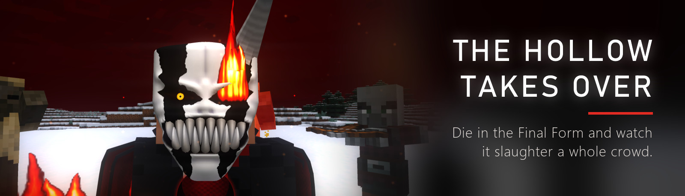

Die in the Final Form, and the sword won't save you. You fall to your knees and drive it into the ground. "This is not over yet." A perfectly round hole opens through your chest, and **you lose control**.

What follows is a fully staged 40-second scene. The Hollow fights on its own, a crowd closes in, it looks up at the red moon, and its eye ignites. Then it leaps through every last one of them, stands behind them and flicks the blood off the blade. Everyone falls apart at once.

You survive, but the mask stays broken for a whole in-game day.

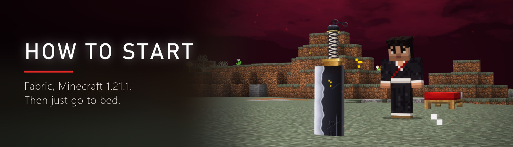

1. Install **Fabric Loader** and **Fabric API** for Minecraft 1.21.1.
2. Put this mod into your `mods` folder.
3. **Go to sleep in a bed.** Everything else comes to you.

**Tip:** abilities only work while the eye is open, so at night or in the dark. Want to try something out in the daytime? Go down into a cave.

| Action | Control |
|---|---|
| Take the sword | Right-click it |
| Execution | Left-click while the needle is in the zone |
| Hollow Form | `H` (can be changed in Controls) |
| Getsuga Tensho | Right-click with the sword in Hollow Form |

*The banners and the video use color-graded footage from the game. The Images tab has plain in-game screenshots.*

---

# Зангецу: твой меч живой, и он выбирает тебя

**Зангецу** — это сюжетный мод на меч для Minecraft по мотивам «Блича». Этот меч нельзя скрафтить или найти в сундуке: он приходит к тебе во сне. С клинка смотрит живой глаз, ваша дружба растёт с каждым боем, а за его силу приходится платить.

*Мод сделал **Dobrelya22**. Claude (ИИ от Anthropic) помогал только с кодом. Бесплатный неофициальный фанатский мод. «Блич», Зангецу, Ичиго и Яхве принадлежат Тайто Кубо и их правообладателям.*

- **Меч приходит сам.** Когда ты впервые ляжешь спать, тебе приснится багровое небо и огромный Яхве. Возьми меч или откажись навсегда.
- **Живой глаз.** Следит за врагами, моргает, и с ним надо подружиться: убивай злых мобов и щади добрых. Открывается ночью и в темноте, и тогда просыпается настоящая сила.
- **Настоящий бой.** Восемь весомых приёмов от первого и третьего лица, стрелы рассекаются в воздухе, конечности отлетают.
- **Казни.** Кликни, пока стрелка в зоне, и меч разрубит саму модель моба: голова с плеч, пополам, ломтями, на четыре части.
- **Форма Пустого.** Клавиша `H`, костяная маска, кровавая луна и Гецуга Теншо.
- **Финальная форма.** Маска с рогом, настоящий огонь, тканевый плащ и звенящие цепи.
- **У смерти есть сюжет.** Яхве раздавит меч в кулаке, чтобы спасти тебя, а настоящий придётся искать среди сотни фальшивых. А если умрёшь в финальной форме, тело заберёт Пустой, и ты будешь только смотреть.

**Как начать:** поставь Fabric Loader и Fabric API для Minecraft 1.21.1, положи мод в папку `mods` и ляг спать в кровать.

---

**Learn more:** [Full guide](https://github.com/Dobrelya22/zangetsu-mod/blob/main/docs/GUIDE.en.md) · [Гайд на русском](https://github.com/Dobrelya22/zangetsu-mod/blob/main/docs/GUIDE.md) · [Source code](https://github.com/Dobrelya22/zangetsu-mod)
