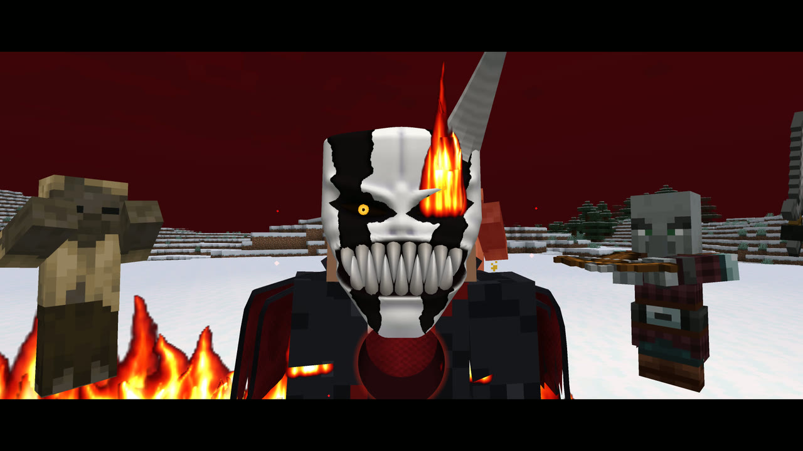
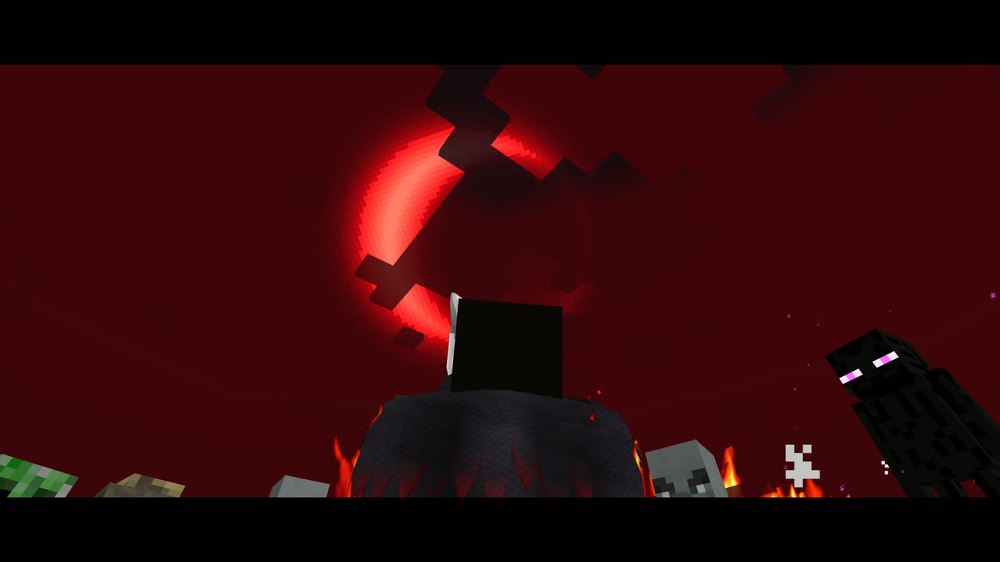
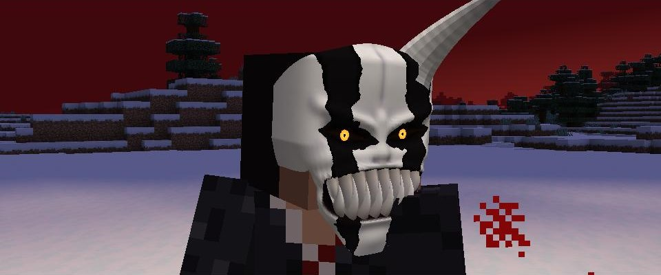
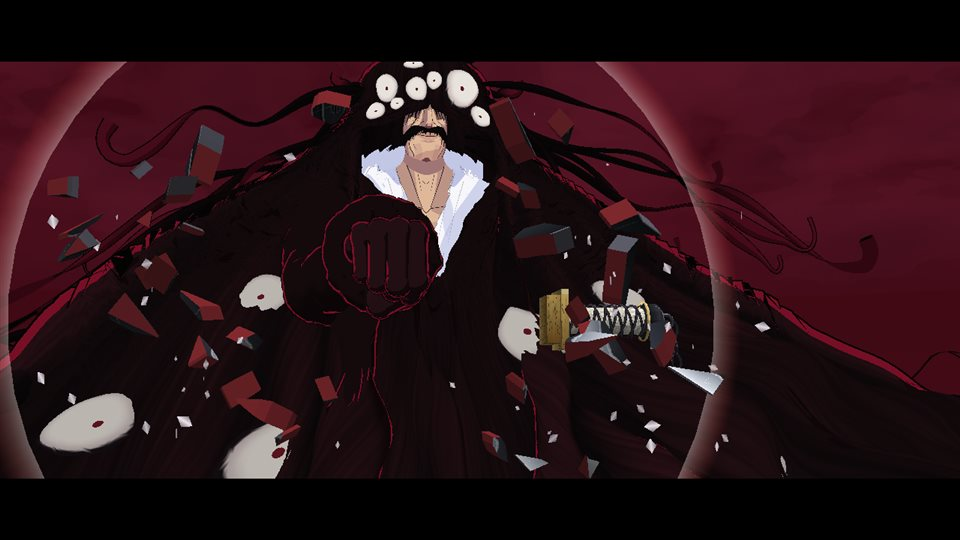
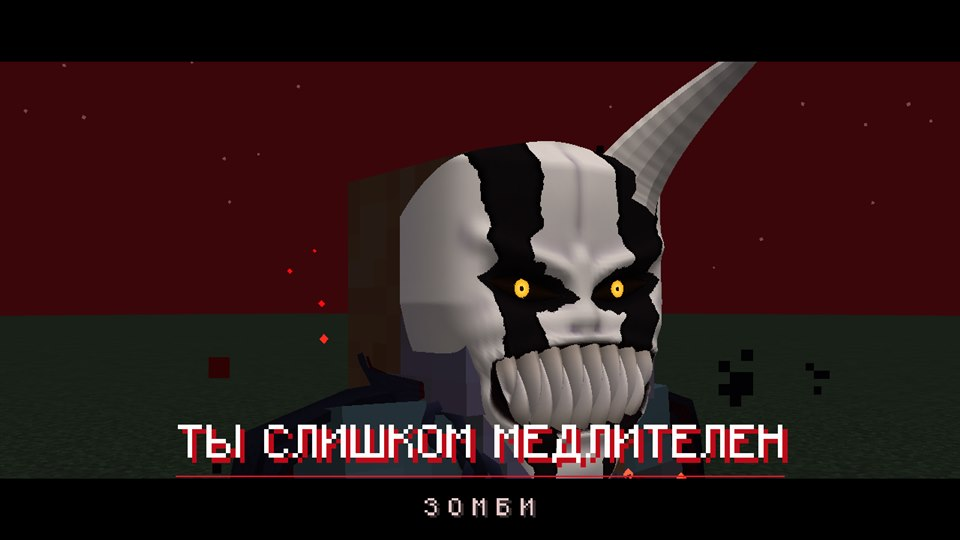

# Zangetsu: a living sword from Bleach

**The sword chooses you in a dream, grows with your bond, cuts mobs apart for real, and turns you into a Hollow.**

*Made by **Dobrelya22**. Claude (Anthropic's AI) helped only with the code. Unofficial fan mod, not affiliated with the creators or rights holders of Bleach.*

## What's inside

**A sword that comes to you.** No crafting. The first time you sleep you dream of a crimson sky and a giant Yhwach, who tells you that you are worthy. Take the sword and wake up with it, or lie back down in your bed and lose it forever.

**A living eye on the blade.** It watches the nearest enemy, follows your cursor in the inventory and blinks. Kill evil mobs and spare the good ones to grow your bond through five levels. The eye opens at night and in the dark, and that is when the abilities wake up.

**Real sword combat.** Eight weighty moves in third and first person. Arrows are sliced in half in mid-air. Attacks are parried and limbs fly off: arms from zombies and skeletons, knees from endermen.

**Executions with a reaction check.** Click while the needle is in the zone. The sword slices the mob's actual model, so pieces are solid and every cut shows the inside. Heads, waists, diagonals, quarters, slices, a different move every time. Hit the white zone in the Final Form for a freeze, "YOU'RE TOO SLOW", and a strike from behind.

**Hollow Form.** Press `H` to pass a hand over your face and put on Ichigo's mask. Strength, speed, a blood-red crescent moon in the sky, and Getsuga Tensho on right-click. The gauge refills every day and with every monster you kill.

**The Final Form.** A horned mask, real fire on your arms and legs, a cloth cloak, heavy ringing chains, and a much bigger Getsuga.

**Death has a story.**
- Die normally and Zangetsu saves you at the cost of itself: Yhwach catches it in his palm and crushes it. Go to sleep and find the true sword among a hundred fakes.
- Die in the Final Form and the Hollow takes your body. A perfectly round hole opens in your chest, and you watch it cut through a whole crowd in a fully staged 40-second scene.

## Quick start

1. Install **Fabric Loader** and **Fabric API** for Minecraft **1.21.1** (Java 21).
2. Put this mod into your `mods` folder. It is required on both client and server.
3. **Go to sleep in a bed.** The rest happens on its own.

| Level | Bond | Unlocks |
|---|---|---|
| I Awakening | 0 | Slices arrows, deflects fireballs and tridents |
| II Trust | 50 | Parrying, severing limbs, executions |
| III Unity | 150 | The sword strikes evil mobs on its own |
| IV Hollow | 350 | Hollow Form (`H`), Getsuga Tensho (RMB) |
| V Final Form | 700 | Horned mask, fire, cloak and chains, long-range executions |

**Tip:** the abilities only work while the eye is open, so at night or in the dark. Hollow Form works in daylight too.

## Guide

- **Full guide:** [English](https://github.com/Dobrelya22/zangetsu-mod/blob/main/docs/GUIDE.en.md) · [Русский](https://github.com/Dobrelya22/zangetsu-mod/blob/main/docs/GUIDE.md)
- **Full description:** [English](https://github.com/Dobrelya22/zangetsu-mod/blob/main/README.en.md) · [Русский](https://github.com/Dobrelya22/zangetsu-mod/blob/main/README.md)
- **Source code:** [GitHub](https://github.com/Dobrelya22/zangetsu-mod)

The game text is available in English and Russian.

---

# Зангецу: живой меч из «Блича»

**Меч выбирает тебя во сне, растёт вместе с вашей дружбой, по-настоящему разрубает мобов и превращает тебя в Пустого.**

*Мод сделал **Dobrelya22**. Claude (ИИ от Anthropic) помогал только с кодом. Неофициальный фанатский мод, не связан с создателями и правообладателями «Блича».*

**Меч приходит сам.** Крафтить ничего не надо. Когда ты впервые ляжешь спать, тебе приснится багровое небо и огромный Яхве. Возьми меч и проснись с ним или вернись в кровать и потеряй его навсегда.

**Живой глаз на клинке.** Следит за врагами и за курсором в инвентаре, моргает. Убивай злых мобов и щади добрых, чтобы пройти пять уровней дружбы. Глаз открывается ночью и в темноте, и тогда просыпаются способности.

**Настоящий бой на мечах.** Восемь весомых приёмов от первого и третьего лица. Стрелы рассекаются в воздухе, удары парируются, конечности отлетают.

**Казни с проверкой реакции.** Кликни, пока стрелка в зоне. Меч режет саму модель моба, поэтому куски объёмные. В финальной форме есть белая зона: стоп-кадр, «ТЫ СЛИШКОМ МЕДЛИТЕЛЕН» и удар в спину.

**Форма Пустого.** Клавиша `H`, маска Ичиго, кровавый серп в небе и Гецуга Теншо на ПКМ. Шкала заполняется каждый день и за каждого убитого монстра.

**Финальная форма.** Маска с рогом, настоящий огонь на руках и ногах, тканевый плащ, тяжёлые звенящие цепи и Гецуга намного крупнее.

**У смерти есть сюжет.** Умрёшь как обычно, и Зангецу спасёт тебя ценой себя: Яхве раздавит его в кулаке, и настоящий меч придётся искать во сне среди сотни фальшивых. Умрёшь в финальной форме, и тело заберёт Пустой: в груди откроется идеально круглая дыра, и ты будешь смотреть, как он рубит целую толпу.

**Как начать:** поставь Fabric Loader и Fabric API для Minecraft 1.21.1, положи мод в папку `mods` и ляг спать в кровать.
